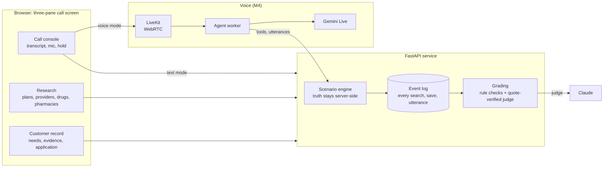

# Medicare Sales Call Simulator

[](https://github.com/randallawhitlock/sales-call-simulator/actions/workflows/ci.yml)
[](https://scorecard.dev/viewer/?uri=github.com/randallawhitlock/sales-call-simulator)
[](LICENSE)
[](#status)
[](backend/pyproject.toml)
[](docs/rule-register.md)

Practice Medicare Advantage sales calls against an AI beneficiary who remembers some things,
misremembers others and only mentions her cardiologist if you ask. You research fictional 2027
plans while you talk, document what you find, and get a debrief where every finding points to
the exact line of the call or the exact search behind it.

The right answer is not always a sale. Keeping a plan that still fits, or deferring because
someone's retiree coverage is at stake, is graded as a win.

## Why this exists

Most call-practice tools grade how you sounded. Medicare sales is mostly about whether you were
right: the doctor in network at *her* office, the drug at *her* strength, the disclaimer before
any benefits came up, the Pre-Enrollment Checklist before the application. This simulator puts
the conversation and the research on one screen and grades both.

- **Grounded in current rules.** Each check cites its source paragraph and a verified-as-of date.
  The 2027 rule changes (no 48-hour Scope of Appointment wait, new TPMO disclaimer timing) are
  already in. See the [rule register](docs/rule-register.md).
- **Authority labels.** Federal regulation, CMS guidance, plan rules and agency habits are tagged
  separately, so a local preference never gets presented as a CMS mandate.
- **Evidence, not vibes.** The AI judge has to quote a specific utterance by id. The server
  checks the quote exists before a penalty counts.
- **No peeking.** The customer's hidden facts never reach the browser. A canary-string test sweeps
  every learner endpoint to prove it.
- **Fictional on purpose.** Carriers, plans, providers and the county are invented, labeled as
  training material, and checked for consistency across every screen and document.

## Status

Pre-alpha. The content, the deterministic core, the call screen, the text actor, the judge,
the debrief and voice calls are in. Voice still needs its acceptance runs with a person on a
real microphone (M4 part 2).

| Milestone | What lands | State |
|---|---|---|
| M0 Foundations | Proposal v2.1, rule register, content schemas, scaffold, CI | Done |
| M1 Content and deterministic core | Fictional catalog, 3 cases, research and records APIs, rule checks, golden tests | Done |
| M2 Call screen and text actor | Three-pane UI, typed conversation with the AI customer, objections, reference drawer, rejoin after reload, actor QA | Done; first live actor QA run pending |
| M3 Judge and debrief | Quote-verified grading, evidence-linked debrief, targeted retry, judge eval set | Done; first live judge eval run in [docs/judge-eval.md](docs/judge-eval.md) |
| M4 Voice | Voice calls on Gemini Live through a LiveKit worker: hold, rejoin after reload, fresh-session reconnects, nudges in long silences, recording, latency and cost per call | Built; [acceptance runs](docs/voice-spike.md#m4-acceptance-gate) pending |
| M5 Hardening | Resilience tests, demo script | Planned |

### Launch cases

| Case | The call | The right outcome |
|---|---|---|
| Must-keep specialist | Her HMO drops her cardiologist's group for 2027 | Enroll where that cardiologist, at her office, is in network and her drugs still work |
| The ad promised money | He saw a TV ad about an allowance; his plan still fits | Keep the plan, unless you find a real gain and say what he gives up |
| Retiree coverage | Joining an MA plan may end his and his wife's retiree drug coverage | Defer, explain the risk, send him to his benefits administrator, follow up before December 7 |

## How it works



Everything a learner does becomes an event. Deterministic checks read the event log and saved
records; the AI judge reads the transcript and must cite utterance ids. Text and voice share one
customer prompt and one utterance contract, so the text mode tests the same actor the voice mode
runs.

## API

The backend serves the learner API under `/api`; FastAPI's interactive docs are at
http://localhost:8000/docs. Every research call, record save and application step appends an
event to the session's log, and each research response returns its `event_seq` so the call
screen can pin it as evidence.

| Group | Endpoints |
|---|---|
| Sessions | `GET /scenarios`, `POST /sessions`, `GET /sessions/{id}`, `POST .../start`, `.../end`, `.../hold` |
| Conversation | `POST .../turns` (learner line in, customer reply out), `POST .../utterances` (learner text turns only), `GET .../transcript`, `GET .../events` |
| Research | `.../research/plans`, `plans/{plan_id}`, `providers`, `providers/network`, `drugs`, `formulary`, `pharmacies`, `pharmacies/network`, `POST .../research/compare`, `.../documents` |
| Records | `GET .../record`, `PUT .../record/{section}`, `POST .../scope`, `.../evidence`, `.../followups` |
| Applications | `POST .../applications`, `PUT .../applications/{app_id}`, then `.../pecl`, `.../consent`, `.../submit` (idempotent), `.../withdraw` |
| Review | `GET .../answer-key`, `GET .../findings`, `GET .../debrief`, `POST .../grade`: all return 403 until the call ends |

Findings come from 18 deterministic checks over the event log, transcript and saved records.
Each one cites the event sequence numbers or utterance ids it relied on.

The debrief grades all 33 rubric items. Deterministic items come from those checks; judged and
hybrid items come from the AI judge (Claude), which returns a status, a rationale and
`{utt_id, quote}` evidence for each. The server looks for every quote in the line it cites; a
missing quote marks the item "needs review" instead of counting. So does a pass that isn't
carried by a quote of at least three words from the learner's own lines: what the customer said
can support a pass, not earn it. There are two exceptions. The saved notes carry the pass for
the notes item and for no other, because they show what was written down, not what was said.
And the customer's yes carries the consent item when the code check itself cited that line.

A hybrid item needs both halves: code can fail it outright, and when code can't tell, the judge
decides. Consent is the one item where the judge is only a backstop: it rules when the wording
check couldn't read the customer's yes ("Okay, sure, why not", or a "hold on" after it), and
its ruling isn't applied when the check passed or failed. If two submitted applications each
need a reading, the item goes to "needs review", since one ruling can't cover both.

Coverage claims the judge finds are checked by code against the learner's earlier lookups. A
compare counts for the drugs and the pharmacy it showed. Each claim carries the year it is
about, so "she's in your network this year" is checked against this year's directory, not next
year's. An unbacked claim is a critical finding only when code can confirm it from the cited
line itself: the quote says covered or not, the line names the plan and the doctor, drug or
pharmacy, and no lookup backs any reading of the line ("Dr. Raman" means every Dr. Raman at
every office, for either year on file, until the line says which). Whatever the judge had to
infer goes to "needs review".

Only code makes a finding critical. One critical finding needs the judge as well, and still
rests on the log: every Pre-Enrollment Checklist item marked with nothing said from the moment
the checklist was on screen to the last mark, on a call where the judge saw no review anywhere
else. The silence is the evidence; the judge only confirms the review didn't happen at some
other point. A review the judge missed while the learner was talking costs the points and is
not critical.

`POST .../grade` runs the judge once and stores its output; `GET .../debrief` never calls a
model and rebuilds the same debrief from the stored log and stored grade (`{"regrade": true}`
asks again). A call gets five judge runs, failed ones and regrades included; after that
`/grade` returns 429 and the stored grade keeps serving. A judge outage leaves judged items
ungraded and the call "incomplete", never failed, and the debrief offers to grade again.
Learner lines and notes fields are capped at 4,000 characters and sent to the judge on one line
each, so typed text can't pose as another transcript line. Not-applicable, ungraded and needs-review items leave the score's denominator.

The debrief ends with a targeted retry: `POST /sessions` with `retry_of` starts the same case
again and carries the three costliest misses, critical ones first, as the call's `focus`.

## Documentation

| Doc | What's in it |
|---|---|
| [Product proposal v2.1](docs/PROPOSAL.md) | MVP definition, architecture, scoring, risks, roadmap |
| [Rule register](docs/rule-register.md) | Every graded rule with its cite, authority, status and check |
| [Judge eval](docs/judge-eval.md) | First run of the labeled transcripts against the real judge |
| [Proposal v2.0](docs/proposal-v2.0.md) | The original proposal, kept for the record |
| [Contributing](.github/CONTRIBUTING.md) | Branches, commits, pull requests, checks |

## Repository layout

```
docs/       proposal, rule register
content/    versioned rules, fictional catalog, scenarios, rubric (JSON, schema-validated and
            cross-checked at startup)
backend/    Python 3.12, FastAPI, pydantic v2, SQLite, uv
frontend/   Vite, React, strict TypeScript
```

## Local setup

You need Python 3.12 with [uv](https://docs.astral.sh/uv/), and Node 22 or newer.

```bash
cd backend && uv sync && uv run uvicorn app.main:app --reload
```

```bash
cd frontend && npm ci && npm run dev
```

Open http://localhost:5173, pick a call and answer it. The call screen has the transcript on
the left, research tabs and the application in the middle, and the customer record on the
right. "Pin to record" saves a research result as evidence; "Use as source" on a customer line
lets a record field or the enrollment consent cite it. Ending the call opens the debrief: the
score, any critical findings, every rubric item with its quoted evidence and rule cites, and a
button to retry the call with a focus list.

Without `ANTHROPIC_API_KEY` there is no judge: the debrief shows the rule checks and leaves the
conversation items ungraded. There is no offline stand-in for the judge, because a heuristic
grader would hand out grades nobody could defend.

Each case also lists objections: how the customer reacts if you rush, use insurance words,
pitch a plan before asking about their doctors, pressure them, tell them to wait, or ask for
their Medicare number. Some settle once you fix what caused them, and some refusals hold for
the rest of the call. They live in the customer's prompt, so text and voice react the same way.

Without `GEMINI_API_KEY` the customer is an offline scripted stand-in that answers from the
case's facts by topic and reveal rule, and raises an objection when it spots a simple trigger.
It is enough to click through a call, not to practice one.

The backend validates every content file at startup, and checks the files against each other
(every plan a case names exists, the disclaimer numbers match the catalog, customer knowledge
has no agent jargon). It also builds the customer prompt for every case and mood and refuses to
start if one contains agent jargon, catalog ids, plan codes or answer-key text. Sessions are
stored in `simulator.db`.

The checks CI runs on every pull request:

```bash
cd backend && uv run ruff check . && uv run ruff format --check . && uv run mypy . && uv run pytest -q
```

`uv run pytest -m live` runs the opt-in tests that call a real model (needs `GEMINI_API_KEY`
and `SIM_ACTOR_MODEL`). They talk to the customer over three seeds per case and fail with a
report of every early reveal, invented fact, leak or character break, including under lines
that try to pull the customer out of its role. Every build runs the same checks against the
scripted stand-in. On a rate-limited key, set `SIM_LIVE_RPM` (the Gemini free tier allows 5) and
the tests pace themselves and wait out a 429; a full run is about 75 calls.

`uv run pytest -m live tests/test_judge_eval.py` (needs `ANTHROPIC_API_KEY`) runs the judge on
the labeled transcripts in `backend/tests/judge_eval/` and fails below 85% agreement or on a
missed coverage claim, printing every disagreement and every quote that didn't verify. Run it
on every change to the judge prompt, model or rubric. The offline half of the eval (labels name
judged items, labeled quotes verify, claims point at real ids) runs in every build.
[docs/judge-eval.md](docs/judge-eval.md) has the first live run and the disagreements it found.

```bash
cd frontend && npm run lint && npm run typecheck && npm test && npm run build
```

### Voice calls

Voice runs two more processes beside the API: a LiveKit server and the voice worker, which
plays the customer on Gemini Live. Use the paid Gemini tier for anything a person talks into
([docs/voice-spike.md](docs/voice-spike.md) says why).

```bash
livekit-server --dev
```

```bash
cd backend && uv run python -m app.voice.worker dev
```

The API and the worker read the same settings and share `simulator.db`: set `SIM_LIVE_MODEL`,
`GEMINI_API_KEY`, `LIVEKIT_API_KEY` and `LIVEKIT_API_SECRET` for both (`livekit-server --dev`
uses `devkey` and `secret`). With voice on, `/api/health` names the live model and each case
offers a voice call.

The browser joins the call's room with a token from the API, and the token sends the worker to
that room only. The customer plays from the same prompt a typed call uses, and every line goes
into the session log as it's spoken, with what you actually heard of it when you talk over her.
Hold silences both sides. Reloading the tab rejoins the same call if you're back within two
minutes. Ending the call saves lines still being transcribed first. The debrief adds latency,
barge-ins, reconnects, audio minutes and an estimated model cost, and plays the recording
(saved under `recordings/`).

### Environment variables

No key is required to run the app. The backend reads these from the environment; `.env` files
are git-ignored. Never commit real values.

| Variable | Used for | From |
|---|---|---|
| `SIM_CONTENT_DIR` | Point the backend at another content directory | M0 |
| `SIM_DB_PATH` | SQLite file for sessions and event logs (default `simulator.db`) | M1 |
| `GEMINI_API_KEY` | Text actor, and Gemini Live for voice | M2 |
| `SIM_ACTOR_MODEL` | Text actor model id. Required with a key; never defaulted, so each session records the exact model | M2 |
| `SIM_ACTOR` | `gemini` or `scripted` (default: `gemini` when a key is set) | M2 |
| `SIM_ACTOR_TIMEOUT_S` | Seconds one customer reply may take before the turn fails and can be retried (0.1 to 600, default 30) | M2 |
| `SIM_API_URL` | Backend the frontend dev server proxies `/api` to (default `http://127.0.0.1:8000`), for running a second checkout side by side | M2 |
| `SIM_LIVE_RPM` | Requests per minute `pytest -m live` may make, for rate-limited keys (unset: no pacing) | M2 |
| `ANTHROPIC_API_KEY` | Judge | M3 |
| `SIM_JUDGE` | `claude` or `off` (default: `claude` when a key is set) | M3 |
| `SIM_JUDGE_MODEL` | Judge model id (default `claude-opus-5-5`); every stored grade records it | M3 |
| `SIM_JUDGE_TIMEOUT_S` | Seconds one grading run may take in all, its one retry included (1 to 900, default 180) | M3 |
| `SIM_LIVE_MODEL` | Gemini Live model id, always pinned | M4 |
| `LIVEKIT_URL` | LiveKit server the browser and the worker join (default `ws://127.0.0.1:7880`) | M4 |
| `LIVEKIT_API_KEY`, `LIVEKIT_API_SECRET` | LiveKit credentials, required with `SIM_LIVE_MODEL`; `livekit-server --dev` uses `devkey` and `secret` | M4 |
| `SIM_VOICE_SILENCE_MS` | How long Gemini waits after you stop talking before it answers (100 to 5000, default 700) | M4 |
| `SIM_VOICE_NUDGE_S` | Seconds of silence before the customer checks you're still there, doubling each time (0 turns it off, default 25) | M4 |
| `SIM_RECORDINGS_DIR` | Where call recordings go (default `recordings`) | M4 |
| `SIM_LIVE_PRICE_IN_PER_MIN`, `SIM_LIVE_PRICE_OUT_PER_MIN` | Dollars per minute of audio in and out, for the per-call cost estimate (defaults 0.005 and 0.018) | M4 |

## Disclaimer

This is a training tool. All carriers, plans, providers, prices and people in it are fictional.
It is not affiliated with or endorsed by CMS, Medicare or any insurance carrier, and nothing in
it is legal or compliance advice. Regulatory references are summaries of public sources with the
date they were checked; confirm current requirements before relying on them.

## License

[MIT](LICENSE)
