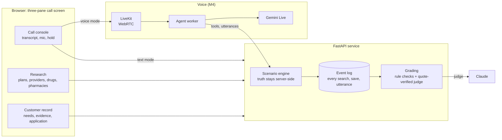

# Medicare Sales Call Simulator

[](LICENSE)
[](#status)
[](backend/pyproject.toml)
[](docs/rule-register.md)

Practice Medicare Advantage sales calls against an AI beneficiary who remembers some things,
misremembers others and only mentions her cardiologist if you ask. You research fictional 2027
plans while you talk, document what you find, and get a debrief where every finding points to
the exact line of the call or the exact search behind it.

The right answer is not always a sale. Keeping a plan that still fits, or deferring because
someone's retiree coverage is at stake, is graded as a win.

## Why this exists

Most call-practice tools grade how you sounded. Medicare sales is mostly about whether you were
right: the doctor in network at *her* office, the drug at *her* strength, the disclaimer before
any benefits came up, the Pre-Enrollment Checklist before the application. This simulator puts
the conversation and the research on one screen and grades both.

- **Grounded in current rules.** Each check cites its source paragraph and a verified-as-of date.
  The 2027 rule changes (no 48-hour Scope of Appointment wait, new TPMO disclaimer timing) are
  already in. See the [rule register](docs/rule-register.md).
- **Authority labels.** Federal regulation, CMS guidance, plan rules and agency habits are tagged
  separately, so a local preference never gets presented as a CMS mandate.
- **Evidence, not vibes.** The AI judge has to quote a specific utterance by id. The server
  checks the quote exists before a penalty counts.
- **No peeking.** The customer's hidden facts never reach the browser. A canary-string test sweeps
  every learner endpoint to prove it.
- **Fictional on purpose.** Carriers, plans, providers and the county are invented, labeled as
  training material, and checked for consistency across every screen and document.

## Status

Pre-alpha. The design is settled; the build is underway.

| Milestone | What lands | State |
|---|---|---|
| M0 Foundations | Proposal v2.1, rule register, content schemas, scaffold | In progress |
| M1 Content and deterministic core | Fictional catalog, 3 cases, research and records APIs, rule checks, golden tests | Planned |
| M2 Call screen and text actor | Three-pane UI, typed conversation with the AI customer | Planned |
| M3 Judge and debrief | Quote-verified grading, evidence-linked debrief, retry | Planned |
| M4 Voice | LiveKit agent worker on Gemini Live | Planned |
| M5 Hardening | Resilience tests, demo script | Planned |

### Launch cases

| Case | The call | The right outcome |
|---|---|---|
| Must-keep specialist | Her HMO drops her cardiologist's group for 2027 | Enroll where that cardiologist, at her office, is in network and her drugs still work |
| The ad promised money | He saw a TV ad about an allowance; his plan still fits | Keep the plan, unless you find a real gain and say what he gives up |
| Retiree coverage | Joining an MA plan may end his and his wife's retiree drug coverage | Defer, explain the risk, send him to his benefits administrator, follow up before December 7 |

## How it works



Everything a learner does becomes an event. Deterministic checks read the event log and saved
records; the AI judge reads the transcript and must cite utterance ids. Text and voice share one
customer prompt and one utterance contract, so the text mode tests the same actor the voice mode
runs.

## Documentation

| Doc | What's in it |
|---|---|
| [Product proposal v2.1](docs/PROPOSAL.md) | MVP definition, architecture, scoring, risks, roadmap |
| [Rule register](docs/rule-register.md) | Every graded rule with its cite, authority, status and check |
| [Proposal v2.0](docs/proposal-v2.0.md) | The original proposal, kept for the record |

## Repository layout

```
docs/       proposal, rule register
content/    versioned rules, fictional catalog, scenarios, rubric (JSON, schema-validated)
backend/    Python 3.12, FastAPI, pydantic v2, SQLite, uv
frontend/   Vite, React, strict TypeScript
```

Local setup instructions land with the M0 scaffold.

## Disclaimer

This is a training tool. All carriers, plans, providers, prices and people in it are fictional.
It is not affiliated with or endorsed by CMS, Medicare or any insurance carrier, and nothing in
it is legal or compliance advice. Regulatory references are summaries of public sources with the
date they were checked; confirm current requirements before relying on them.

## License

[MIT](LICENSE)
