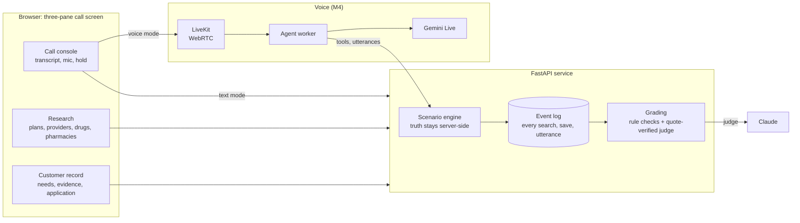

# Medicare Sales Call Simulator

[](https://github.com/randallawhitlock/sales-call-simulator/actions/workflows/ci.yml)
[](https://scorecard.dev/viewer/?uri=github.com/randallawhitlock/sales-call-simulator)
[](LICENSE)
[](#status)
[](backend/pyproject.toml)
[](docs/rule-register.md)

Practice Medicare Advantage sales calls against an AI beneficiary who remembers some things,
misremembers others and only mentions her cardiologist if you ask. You research fictional 2027
plans while you talk, document what you find, and get a debrief where every finding points to
the exact line of the call or the exact search behind it.

The right answer is not always a sale. Keeping a plan that still fits, or deferring because
someone's retiree coverage is at stake, is graded as a win.

## Why this exists

Most call-practice tools grade how you sounded. Medicare sales is mostly about whether you were
right: the doctor in network at *her* office, the drug at *her* strength, the disclaimer before
any benefits came up, the Pre-Enrollment Checklist before the application. This simulator puts
the conversation and the research on one screen and grades both.

- **Grounded in current rules.** Each check cites its source paragraph and a verified-as-of date.
  The 2027 rule changes (no 48-hour Scope of Appointment wait, new TPMO disclaimer timing) are
  already in. See the [rule register](docs/rule-register.md).
- **Authority labels.** Federal regulation, CMS guidance, plan rules and agency habits are tagged
  separately, so a local preference never gets presented as a CMS mandate.
- **Evidence, not vibes.** The AI judge has to quote a specific utterance by id. The server
  checks the quote exists before a ruling counts. One that doesn't check out is held for review
  and left out of the score.
- **No peeking.** The customer's hidden facts never reach the browser. A canary-string test sweeps
  every learner endpoint to prove it.
- **Fictional on purpose.** Carriers, plans, providers and the county are invented, labeled as
  training material, and checked for consistency across every screen and document.

## Status

Pre-alpha. The content, the deterministic core, the call screen, the text actor, the judge and
the debrief are in. Next up is voice (M4).

| Milestone | What lands | State |
|---|---|---|
| M0 Foundations | Proposal v2.1, rule register, content schemas, scaffold, CI | Done |
| M1 Content and deterministic core | Fictional catalog, 3 cases, research and records APIs, rule checks, golden tests | Done |
| M2 Call screen and text actor | Three-pane UI, typed conversation with the AI customer, objections, reference drawer, rejoin after reload, actor QA | Done; first live actor QA run pending |
| M3 Judge and debrief | Quote-verified grading, evidence-linked debrief, retry | Done; first live judge eval run pending |
| M4 Voice | LiveKit agent worker on Gemini Live | Planned; spike run, see [docs/voice-spike.md](docs/voice-spike.md) |
| M5 Hardening | Resilience tests, demo script | Planned |

### Launch cases

| Case | The call | The right outcome |
|---|---|---|
| Must-keep specialist | Her HMO drops her cardiologist's group for 2027 | Enroll where that cardiologist, at her office, is in network and her drugs still work |
| The ad promised money | He saw a TV ad about an allowance; his plan still fits | Keep the plan, unless you find a real gain and say what he gives up |
| Retiree coverage | Joining an MA plan may end his and his wife's retiree drug coverage | Defer, explain the risk, send him to his benefits administrator, follow up before December 7 |

## How it works



Everything a learner does becomes an event. Deterministic checks read the event log and saved
records; the AI judge reads the transcript and must cite utterance ids. Text and voice share one
customer prompt and one utterance contract, so the text mode tests the same actor the voice mode
runs.

## API

The backend serves the learner API under `/api`; FastAPI's interactive docs are at
http://localhost:8000/docs. Every research call, record save and application step appends an
event to the session's log, and each research response returns its `event_seq` so the call
screen can pin it as evidence.

| Group | Endpoints |
|---|---|
| Sessions | `GET /scenarios`, `POST /sessions` (`retry_of` starts another attempt at an ended call's case), `GET /sessions/{id}`, `POST .../start`, `.../end`, `.../hold` |
| Conversation | `POST .../turns` (learner line in, customer reply out), `POST .../utterances` (learner text turns only), `GET .../transcript`, `GET .../events` |
| Research | `.../research/plans`, `plans/{plan_id}`, `providers`, `providers/network`, `drugs`, `formulary`, `pharmacies`, `pharmacies/network`, `POST .../research/compare`, `.../documents` |
| Records | `GET .../record`, `PUT .../record/{section}`, `POST .../scope`, `.../evidence`, `.../followups` |
| Applications | `POST .../applications`, `PUT .../applications/{app_id}`, then `.../pecl`, `.../consent`, `.../submit` (idempotent), `.../withdraw` |
| Review | `GET .../debrief`, `POST .../debrief/judge`, `GET .../findings`, `GET .../answer-key`, `GET .../actor-qa`: all return 403 until the call ends |

Findings come from 18 deterministic checks over the event log, transcript and saved records.
Each one cites the event sequence numbers or utterance ids it relied on.

The debrief scores the 100-point rubric from those checks and the judge:

- **The judge quotes, the server verifies.** Each ruling cites `{utt_id, quote}`. The server
  looks for the quote in that utterance, on whole words, in what was actually heard. A ruling
  with a quote it can't find, or a pass or fail with no quote, is "held for review".
- **Hybrid criteria say how the two combine.** Some need both (the checklist items were marked
  and gone through with the customer). Some use the judge as a backstop: it rules only where
  the wording check couldn't tell, and if it reads a failed line as fine, the item goes to
  review instead of flipping to a pass.
- **Coverage claims are checked against the log.** The judge lists each time the learner said a
  doctor, drug or pharmacy is covered or in network. Code looks for a lookup, made before that
  line, that showed it. A claim with nothing behind it is a critical finding.
- **What counts toward the score.** Pass, fail and not-observed items count toward the total.
  Not-applicable, ungraded and held items leave it. "Not observed" is the judge saying the
  agent never did something; there is no line to quote for an absence, so it scores zero but
  can never be a critical finding. With no judge, or a judge that didn't answer, the call is
  "incomplete", never failed.
- **Graded once.** `GET .../debrief` never calls the judge. `POST .../debrief/judge` asks it
  once and stores the output with the model that answered; later debriefs reuse it until
  someone sends `{"regrade": true}`, which adds an attempt and keeps the old one.

The debrief also carries a plain-language timeline of everything the learner did, the case's
outcomes and traps, each criterion's authority label (regulation, CMS guidance, plan rule,
organization policy or training objective, with unverified cites marked), and up to three
things to work on. "Retry this call" starts the same case again with those shown on the
incoming-call card.

## Documentation

| Doc | What's in it |
|---|---|
| [Product proposal v2.1](docs/PROPOSAL.md) | MVP definition, architecture, scoring, risks, roadmap |
| [Rule register](docs/rule-register.md) | Every graded rule with its cite, authority, status and check |
| [Proposal v2.0](docs/proposal-v2.0.md) | The original proposal, kept for the record |
| [Contributing](.github/CONTRIBUTING.md) | Branches, commits, pull requests, checks |

## Repository layout

```
docs/       proposal, rule register
content/    versioned rules, fictional catalog, scenarios, rubric (JSON, schema-validated and
            cross-checked at startup)
backend/    Python 3.12, FastAPI, pydantic v2, SQLite, uv
frontend/   Vite, React, strict TypeScript
```

## Local setup

You need Python 3.12 with [uv](https://docs.astral.sh/uv/), and Node 22 or newer.

```bash
cd backend && uv sync && uv run uvicorn app.main:app --reload
```

```bash
cd frontend && npm ci && npm run dev
```

Open http://localhost:5173, pick a call and answer it. The call screen has the transcript on
the left, research tabs and the application in the middle, and the customer record on the
right. "Pin to record" saves a research result as evidence; "Use as source" on a customer line
lets a record field or the enrollment consent cite it. Ending the call opens the debrief:
the score, each finding with links into the call record beside it, and a retry.

Each case also lists objections: how the customer reacts if you rush, use insurance words,
pitch a plan before asking about their doctors, pressure them, tell them to wait, or ask for
their Medicare number. Some settle once you fix what caused them, and some refusals hold for
the rest of the call. They live in the customer's prompt, so text and voice react the same way.

Without `GEMINI_API_KEY` the customer is an offline scripted stand-in that answers from the
case's facts by topic and reveal rule, and raises an objection when it spots a simple trigger.
It is enough to click through a call, not to practice one.

Without `ANTHROPIC_API_KEY` there is no judge. The debrief still opens with everything the rule
checks can settle; the conversation items show as not graded and the call as incomplete.

The backend validates every content file at startup, and checks the files against each other
(every plan a case names exists, the disclaimer numbers match the catalog, customer knowledge
has no agent jargon). It also builds the customer prompt for every case and mood and refuses to
start if one contains agent jargon, catalog ids, plan codes or answer-key text. Sessions are
stored in `simulator.db`.

The checks CI runs on every pull request:

```bash
cd backend && uv run ruff check . && uv run ruff format --check . && uv run mypy . && uv run pytest -q
```

`uv run pytest -m live` runs the opt-in tests that call a real model (needs `GEMINI_API_KEY`
and `SIM_ACTOR_MODEL`). They talk to the customer over three seeds per case and fail with a
report of every early reveal, invented fact, leak or character break, including under lines
that try to pull the customer out of its role. Every build runs the same checks against the
scripted stand-in. On a rate-limited key, set `SIM_LIVE_RPM` (the Gemini free tier allows 5) and
the tests pace themselves and wait out a 429; a full run is about 75 calls.

With `ANTHROPIC_API_KEY` set, `pytest -m live` also runs the judge eval set: six scripted calls
across the three cases, each labeled with the rulings a human grader gives. It makes six judge
calls and fails with a report if the judge disagrees on anything that makes or clears a critical
finding, agrees with fewer than 80% of the labels, or cites quotes the server can't find.
Every build checks the labels themselves with a stand-in judge, so no build depends on a model.
It has not been run against the real judge yet.

```bash
cd frontend && npm run lint && npm run typecheck && npm test && npm run build
```

### Environment variables

No key is required to run the app. The backend reads these from the environment; `.env` files
are git-ignored. Never commit real values.

| Variable | Used for | From |
|---|---|---|
| `SIM_CONTENT_DIR` | Point the backend at another content directory | M0 |
| `SIM_DB_PATH` | SQLite file for sessions and event logs (default `simulator.db`) | M1 |
| `GEMINI_API_KEY` | Text actor, and Gemini Live for voice | M2 |
| `SIM_ACTOR_MODEL` | Text actor model id. Required with a key; never defaulted, so each session records the exact model | M2 |
| `SIM_ACTOR` | `gemini` or `scripted` (default: `gemini` when a key is set) | M2 |
| `SIM_ACTOR_TIMEOUT_S` | Seconds one customer reply may take before the turn fails and can be retried (0.1 to 600, default 30) | M2 |
| `SIM_API_URL` | Backend the frontend dev server proxies `/api` to (default `http://127.0.0.1:8000`), for running a second checkout side by side | M2 |
| `SIM_LIVE_RPM` | Requests per minute `pytest -m live` may make, for rate-limited keys (unset: no pacing) | M2 |
| `ANTHROPIC_API_KEY` | Judge. Unset: no judge, and calls grade as incomplete | M3 |
| `SIM_JUDGE` | `claude` or `off` (default: `claude` when a key is set) | M3 |
| `SIM_JUDGE_MODEL` | Judge model id (default `claude-opus-5-5`). Each judgment stores the model asked and the model that answered: if the model declines a request, Anthropic's server-side fallback reruns it on that model's default fallback | M3 |
| `SIM_JUDGE_TIMEOUT_S` | Seconds one grading request may take (5 to 1800, default 300) | M3 |
| `SIM_LIVE_MODEL` | Gemini Live model id, always pinned | M4 |
| `LIVEKIT_URL` | LiveKit server (default `ws://localhost:7880`) | M4 |
| `LIVEKIT_API_KEY`, `LIVEKIT_API_SECRET` | LiveKit credentials; `livekit-server --dev` prints its own | M4 |

## Disclaimer

This is a training tool. All carriers, plans, providers, prices and people in it are fictional.
It is not affiliated with or endorsed by CMS, Medicare or any insurance carrier, and nothing in
it is legal or compliance advice. Regulatory references are summaries of public sources with the
date they were checked; confirm current requirements before relying on them.

## License

[MIT](LICENSE)
